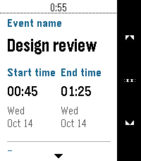

# PebbleCal

A native agenda and month calendar for Pebble Time 2 (`emery`). It reads the calendars already enabled in Pebble Core through the built-in experimental Calendar plugin. The basic agenda works with unmodified Core. Optional attendee support uses the Core enhancement below. Calendar data stays on your phone and watch, with no Google login, ICS link, hosted settings page, backend or separate iPhone app.

**Current provider limit: the next 10 events across all enabled calendars, within seven days. Completed events are excluded. This is not a complete daily agenda.** A day with no displayed events means none were in the received list, not that your calendar is free.

Synthetic emulator previews (no real calendar data):

 

The detail screen has separate Event Name, Start Time, End Time, Room, Attendee List and Calendar sections. **Official Core 1.15.0.1 does not expose attendees** even though native Timeline can show them. PebbleCal 0.3 and later automatically request attendee names when an enhanced Core plugin advertises support, separates room resources from people, and extracts office, building, floor/room, name and capacity. With the current official release, attendees still say “Not provided by phone”; matching event Location text remains a labeled room fallback.

A reviewable [Core Calendar enhancement](integrations/core-calendar/README.md) reuses the existing native reader and permissions. It includes source changes, synthetic Core tests and Mac/iPhone build instructions. Installing the PBW alone cannot activate it; attendee support requires a Core build containing that patch or a future official release adopting the contract. It has not been submitted upstream or verified on iPhone.

The room format is `OFFICE | address BUILDING-floorOrdinal-floor.room Room Name (capacity) [facilities]`. The parser extracts office, building, floor, room number, name, capacity and optional facilities, checks that both floor identifiers agree, and separates resource attendees from people. Numeric room numbers drop leading zeroes. The room card identifies whether the source was an attendee or Location. Unrecognized locations remain visible as ordinary text; no office/floor/capacity is guessed.

## iPhone prerequisites

- Pebble Core **1.15.0.1** or a compatible newer release. The preview API can change.
- Settings → Debug → Show debug options → **Use experimental plugins / permissions** enabled.
- Core has full Calendar access in iOS Settings, and your desired calendars are enabled in Core.
- Your Time 2 is connected to the phone.

The app declares only the `Calendar` permission in a version-2 app manifest. If Core requests permission, approve it on the phone and refresh the watch app. Do not grant access to corporate calendars unless your employer's rules permit this custom app to read/display them.

## Controls

PebbleCal opens to **today's agenda**. The native menu's first row is **Calendar & options**; events follow in chronological order. Press Up to reach that row if it is above the selected event.

| Button | Agenda | Month calendar | Event details |
| --- | --- | --- | --- |
| Up / Down | Previous / next menu item | Previous / next date | Scroll content |
| Select | Open options or selected event | Open the selected day's agenda | Open options (ellipsis icon) |
| Back | Exit the app | Cancel browsing and return to agenda | Return to agenda |
| Hold Up / Down | Native menu repeat | Previous / next month | Native scroll repeat |
| Hold Select | Options shortcut | Options shortcut | — |

The native action menu offers Calendar, Today, Previous/Next day, Previous/Next month, Refresh and Clear saved events. Changing months opens the calendar. Clear requires confirmation with Select; Back cancels. Double Select is no longer required. Back always follows the native window stack; long Back remains reserved by firmware.

The top status bar shows the current time for comparing it with appointments. Ordinary labels and body text use at least size 18; headings use 24–28. The largest system text setting expands body text and stacks start/end fields in details. [Design decisions and source review](docs/design.md) describe the Pebble guides, nested pages, example repositories and icon licenses.

## Build locally

Use the same local SDK flow as `pebble-flight` and `pebble-transit`. Clone this separate project under `~/Developer/pebble-calendar` if working on your Mac.

If your existing `pebble` CLI and SDK work, the scripts use them when no project-local virtual environment exists. The tested versions for this project are **pebble-tool 5.0.40** and **SDK 4.33.1**.

For a fresh Mac setup:

```sh
brew install uv python@3.13 node
cd ~/Developer/pebble-calendar
./scripts/setup.sh
```

Setup creates an ignored `.tools/venv`; Linux SDK/cache data also stays under `.tools`. On macOS the SDK uses its normal Application Support directory. The restricted cloud workspace additionally needs a temporary CLI symlink adjustment; `prepare-toolchain.py` applies it only if `/var/tmp` is read-only. It does not change Core or the watch SDK API.

Build the live app:

```sh
./scripts/build.sh
```

The installable package is **`dist/pebble-calendar.pbw`**. `build/pebble-calendar.pbw` is also generated, but always represents whichever mode you built most recently. Use the explicitly named `dist` file for installation. The packaging step adds Core 1.15's permission metadata; plain `pebble build` alone is not the complete production workflow.

## Synthetic emulator demo

```sh
./scripts/build.sh --demo
./scripts/emulator.sh
./scripts/pebble.sh screenshot --emulator emery --vnc --no-open test-output/agenda.png
./scripts/pebble.sh emu-button click select --emulator emery --vnc
./scripts/pebble.sh logs --emulator emery --vnc
```

The demo PBW is `dist/pebble-calendar-demo.pbw`, named **PebbleCal Demo**. It shows **DEMO** and uses only made-up events, attendees and a fictional room resource. It never substitutes synthetic events in the live app. The two builds intentionally share an app UUID: installing one replaces the other, and a cache from the other mode is discarded on opening. Version 0.2 upgraded the event/cache format; versions 0.3–0.4 retain it; an old 0.1 cache is discarded and refreshed through Core.

The standard emulator does not implement Core's native Calendar plugin. Use the demo for UI testing. Installing the live PBW in that emulator should report that plugins need enabling; it cannot prove iPhone calendar access. `--vnc` works in a headless environment as well as on a Mac.

## Install on your Time 2

For the local deployment path, enable **Use LAN developer connection** in Core's Phone → Connectivity settings, then enable **Dev Connection** for the connected watch in Devices. Use the phone's displayed address on a trusted local network:

```sh
./scripts/build.sh
./scripts/install.sh PHONE_IP
./scripts/pebble.sh logs --phone PHONE_IP
```

Alternatively, send `dist/pebble-calendar.pbw` to your iPhone with AirDrop and open it in Pebble Core from Files/the share sheet. A cloud Developer Connection also works through `./scripts/pebble.sh login` and `./scripts/pebble.sh install --cloudpebble dist/pebble-calendar.pbw`; LAN or Files avoids needing that service for installation.

Do not capture screenshots of actual corporate events or enable logging that includes event content. This app's own log output includes counts and cache status only.

## Offline behavior and privacy

The watch opens its last complete snapshot immediately and asks Core for fresh events. While open, it subscribes to provider changes; Bluetooth updates contain only changed snapshots. An interrupted transfer, bad payload or ordinary sync failure leaves the last complete list available. A successful empty snapshot clears the previous event list. Revoking the app's Calendar permission clears its cache when Core reports `PERMISSION_DENIED`.

The app keeps no persistent phone-side event cache, makes no web requests and uploads no events. Watch caching creates a bounded extra local copy. Cached snapshots are valid for **24 hours**; expired data is deleted when the app next runs/checks its clock. The app cannot erase flash on a timer while closed. Options → Clear saved events → Select to confirm erases the app's saved data and pauses refresh for that session until you choose Refresh. Keep real event data out of repository files and shared artifacts.

## Tests and validation

```sh
./scripts/test.sh
```

Requires Node.js and a host C compiler (`cc`; Xcode Command Line Tools on macOS). Tests use synthetic events only. They cover provider validation, chronological merging, missing fields, UTF-8 bounds, empty/update/delete snapshots, message acknowledgments, stale subscription callbacks, and error redaction. Native tests exercise date boundaries, midnight spans, all-day date semantics, 23/25-hour DST days, cache expiry/corruption and every interruption point in a cache write.

Build and emulator validation were performed in the cloud workspace. The original live app was successfully installed through the cloud Developer Connection. Actual EventKit delivery through your iPhone on iOS 27 and background suspension/reconnect behavior still need the [device checklist](docs/device-validation.md). No real personal or corporate events were accessed during development.

## Limitations and troubleshooting

- **Only 10 events / seven days:** busy calendars can exhaust the limit before tomorrow. There is no pagination, complete-day coverage indicator, historical query or descriptions in the provider. Extending those needs an upstream Core API change.
- **Canceled/declined events:** the provider omits cancellation status and differs from Timeline's declined-event filter. The app cannot independently filter canceled records that EventKit still returns.
- **Updates while closed:** PKJS stops when the watch app closes. iOS can suspend Core, delaying timers and updates. Open Core and use Refresh when needed; no real-time/background guarantee is made.
- **Enable plugins:** verify the debug toggle and supported Core version; reopen this app after enabling it.
- **Allow Calendar access:** check Core's iOS full calendar permission, its enabled calendar list, and the custom app's Calendar permission; refresh afterward. Core may return an empty list when OS permission is missing, which cannot be distinguished from no available events by this provider alone.
- **Sync failed/offline:** check watch connection, open Core, then Options → Refresh. Cached data stays visibly marked.
- **RAM only:** firmware storage is too small or a cache write failed; the current list works until exit but may not survive restarting. Current emery SDK supplies `persist_get_max_size`; this MVP is intended for current firmware.
- **Attendees missing:** Core's plugin does not expose them. Native Timeline uses a separate synchronization path that includes attendee text. An upstream plugin extension is required for live attendee lists and rooms found only in attendee resources.
- **Demo data after installation:** install the live `dist/pebble-calendar.pbw`, named PebbleCal; the demo is a separate explicitly named build.
- **SDK/editor issues:** use `./scripts/pebble.sh --version`; install an emery-capable SDK; avoid mixing `.tools` with another repository's virtual environment. In sandboxed cloud execution, emulator commands need local socket permission. STPyV8 requires ICU data in its standard per-user cache; this was prepared separately in the development environment.

See [architecture](docs/architecture.md) and [development references](docs/references.md). Future work includes an official bounded date-range provider with stable occurrence IDs, coverage/pagination and cancellation metadata. No CI/CD or additional hosting is introduced.
