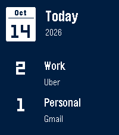
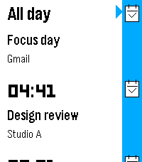

# PebbleCal

A native day overview, animated event timeline and month calendar for Pebble Time 2 (`emery`). It reads the calendars already enabled in Pebble Core through the built-in experimental Calendar plugin. No Google login, ICS link, hosted configuration, new backend or separate iPhone app is required.

**Version 0.6 is a development draft.** Builds and host tests pass, but event-detail redraw and repeated synthetic room entry are not reliably validated in the emulator. A blank-detail redraw also reproduced with the previous 0.5 source in the same emulator. The cause is unresolved; this does not establish that the physical watch is affected or unaffected. The live 0.6.0 draft was successfully installed through CloudPebble on 2026-10-14; installation alone does not verify the UI or microphone behavior. See [validation](docs/validation.md).

**Provider limit: ten upcoming events across all enabled calendars, within seven days. Completed events are excluded. Counts represent received entries, not a complete day's schedule.** Past dates ordinarily have no historical data. A dash means counts are unavailable, rather than zero. Zero only means no matching entries were received for that date.

Synthetic emulator previews (no real calendar data):

  

The overview and details use white text on full-screen charcoal for past dates, navy for today and dark teal for future dates. The overview contains the date and separate Work/Personal counts. Calendar labels containing **Uber** default to Work; labels containing **Gmail** default to Personal, without assuming that a calendar's name identifies its account. Other received calendars have a separate count. For custom names, hold Select → Calendar groups → select a calendar → Work/Personal/Other. Preferences stay on the watch; no real calendar names are hardcoded in the repository. Identical calendar labels cannot be distinguished by this provider.

The day's list follows native Timeline: white event cards with start time, title and location/source, a blue icon rail and a short easing animation on Up/Down. The detail page contains only the date icon, start/end markers and wrapped title, plus a room section **only after the user enters a room**. There are no clock bars, instructional footers, freshness labels, attendee lists or automatic location/room sections on these three pages.



## Voice room entry

In event details, press Select and say a building and floor/room number, for example **“MB4 nine point seventeen.”** Confirm the native dictation transcription. The parser accepts `MB4 9.17`, spaced building letters, spoken numbers and “point”/“dot”; it rejects missing separators, incomplete or ambiguous input and out-of-range numbers. The result shows a door icon, building, floor and room number. Select again replaces the local note. Canceling dictation keeps the previous note.

This is a watch-only annotation; it does not edit or invite a room in Apple/Google Calendar. At most ten notes are kept locally, with a 24-hour limit. Notes match the received calendar name, title, start and end; changed/deleted events or a revoked Calendar permission remove the corresponding notes. Because the provider has no stable occurrence IDs, identical records cannot be distinguished. Clear saved events also clears room notes. Calendar grouping preferences retain only name hashes and categories.

Dictation uses **Core's existing speech service**, not a new companion app. Core 1.15.0.1 supports local/cloud speech routing; the public watch API does not let this app choose the provider. Spoken audio follows Core's selected provider and may require a model download, speech permission or connectivity. PebbleCal sends no event titles or calendar payloads to the speech service and does not log transcripts. Choose an appropriate local speech mode in Core if the spoken room information must remain on-device. Actual microphone recognition on the user's watch still requires device verification.

The earlier [Core attendee enhancement proposal](integrations/core-calendar/README.md) is retained for reference. The 0.6 live adapter does not request or retain attendee names, and this design does not require that patch. Automatic attendee-derived rooms from older versions are not shown; unused metadata in the watch cache is cleared on upgrade/refresh.

## iPhone prerequisites

- Pebble Core **1.15.0.1** or a compatible newer release. The preview API can change.
- Settings → Debug → Show debug options → **Use experimental plugins / permissions** enabled.
- Core has full Calendar access in iOS Settings, and your desired calendars are enabled in Core.
- Your Time 2 is connected to the phone.

The app declares only the `Calendar` permission in a version-2 app manifest. If Core requests permission, approve it on the phone and refresh the watch app. Do not grant access to corporate calendars unless your employer's rules permit this custom app to read/display them.

## Controls

PebbleCal opens to today's overview. Up/Down change dates, and Select opens the day even when the received list is empty. Hold Select opens options.

| Button | Overview | Day timeline | Month calendar | Event details |
| --- | --- | --- | --- | --- |
| Up / Down | Previous / next day | Previous / next event | Previous / next date | Scroll |
| Select | Open day | Open event | Use date | Dictate room |
| Back | Exit | Return to overview | Cancel browsing | Return to timeline |
| Hold Up / Down | Repeat days | Repeat events | Previous / next month | Repeat scrolling |
| Hold Select | Options | Options | Options | — |

Options contain Calendar, Today, day/month navigation, Refresh, Clear saved events and Calendar groups. Clearing requires confirmation; Back cancels. Native window stacking governs Back; long Back remains reserved by firmware. The month grid and settings retain standard native components, while the overview, timeline and details use the requested minimal layout.

System fonts and the largest text preference are supported. Animations run for 180 ms only when navigating the timeline; there is no idle animation timer or additional calendar polling. [Design decisions and source review](docs/design.md) describe the Pebble guides and firmware references.

## Build locally

Use the same local SDK flow as `pebble-flight` and `pebble-transit`. Clone this separate project under `~/Developer/pebble-calendar` if working on your Mac.

If your existing `pebble` CLI and SDK work, the scripts use them when no project-local virtual environment exists. The tested versions for this project are **pebble-tool 5.0.40** and **SDK 4.33.1**.

For a fresh Mac setup:

```sh
brew install uv python@3.13 node
cd ~/Developer/pebble-calendar
./scripts/setup.sh
```

Setup creates an ignored `.tools/venv`; Linux SDK/cache data also stays under `.tools`. On macOS the SDK uses its normal Application Support directory. The restricted cloud workspace additionally needs a temporary CLI symlink adjustment; `prepare-toolchain.py` applies it only if `/var/tmp` is read-only. It does not change Core or the watch SDK API.

Build the live app:

```sh
./scripts/build.sh
```

The installable package is **`dist/pebble-calendar.pbw`**. `build/pebble-calendar.pbw` is also generated, but always represents whichever mode you built most recently. Use the explicitly named `dist` file for installation. The packaging step adds Core 1.15's permission metadata; plain `pebble build` alone is not the complete production workflow.

## Synthetic emulator demo

```sh
./scripts/build.sh --demo
./scripts/emulator.sh
./scripts/pebble.sh screenshot --emulator emery --vnc --no-open test-output/agenda.png
./scripts/pebble.sh emu-button click select --emulator emery --vnc
./scripts/pebble.sh logs --emulator emery --vnc
```

The demo PBW is `dist/pebble-calendar-demo.pbw`, named **PebbleCal Demo**. Its launcher name identifies the demo; the requested minimal pages carry no DEMO status text. It uses only made-up events and a synthetic voice-room result. Select in demo details supplies “MB2 three point seven” without recording audio; the live build always uses real dictation. It never substitutes synthetic events in the live app. The two builds intentionally share an app UUID: installing one replaces the other, and a cache from the other mode is discarded on opening. Version 0.2 upgraded the event/cache format; versions 0.3–0.6 retain it; an old 0.1 cache is discarded and refreshed through Core.

The standard emulator does not implement Core's native Calendar plugin. Use the demo for UI testing. Installing the live PBW in that emulator should report that plugins need enabling; it cannot prove iPhone calendar access. `--vnc` works in a headless environment as well as on a Mac.

## Install on your Time 2

For the local deployment path, enable **Use LAN developer connection** in Core's Phone → Connectivity settings, then enable **Dev Connection** for the connected watch in Devices. Use the phone's displayed address on a trusted local network:

```sh
./scripts/build.sh
./scripts/install.sh PHONE_IP
./scripts/pebble.sh logs --phone PHONE_IP
```

Alternatively, send `dist/pebble-calendar.pbw` to your iPhone with AirDrop and open it in Pebble Core from Files/the share sheet. A cloud Developer Connection also works through `./scripts/pebble.sh login` and `./scripts/pebble.sh install --cloudpebble dist/pebble-calendar.pbw`; LAN or Files avoids needing that service for installation.

Do not capture screenshots of actual corporate events or enable logging that includes event content. This app's own log output includes counts and cache status only.

## Offline behavior and privacy

The watch opens its last complete snapshot immediately and asks Core for fresh events. While open, it subscribes to provider changes; Bluetooth updates contain only changed snapshots. An interrupted transfer, bad payload or ordinary sync failure leaves the last complete list available. A successful empty snapshot clears the previous event list. Revoking the app's Calendar permission clears its cache when Core reports `PERMISSION_DENIED`.

The app keeps no persistent phone-side event cache, makes no web requests and uploads no events. Watch caching creates a bounded extra local copy. Cached snapshots are valid for **24 hours**; expired data is deleted when the app next runs/checks its clock. The app cannot erase flash on a timer while closed. Options → Clear saved events → Select to confirm erases the app's saved data and pauses refresh for that session until you choose Refresh. Keep real event data out of repository files and shared artifacts.

## Tests and validation

```sh
./scripts/test.sh
```

Requires Node.js and a host C compiler (`cc`; Xcode Command Line Tools on macOS). Tests use synthetic events only. They cover provider validation, chronological merging, missing fields, UTF-8 bounds, empty/update/delete snapshots, message acknowledgments, stale subscription callbacks, and error redaction, and ignoring unused attendee fields even when advertised. Native room tests cover spoken-number parsing, malformed input, grouping, conservative event matching, persistence, expiry and deletion. Native date tests exercise date boundaries, midnight spans, all-day date semantics, 23/25-hour DST days, cache expiry/corruption and every interruption point in a cache write.

Build and emulator validation were performed in the cloud workspace. The original live app was successfully installed through the cloud Developer Connection. Actual EventKit delivery through your iPhone on iOS 27 and background suspension/reconnect behavior still need the [device checklist](docs/device-validation.md). No real personal or corporate events were accessed during development.

## Limitations and troubleshooting

- **Only 10 events / seven days:** busy calendars can exhaust the limit before tomorrow. There is no pagination, complete-day coverage indicator, historical query or descriptions in the provider. Extending those needs an upstream Core API change.
- **Canceled/declined events:** the provider omits cancellation status and differs from Timeline's declined-event filter. The app cannot independently filter canceled records that EventKit still returns.
- **Updates while closed:** PKJS stops when the watch app closes. iOS can suspend Core, delaying timers and updates. Open Core and use Refresh when needed; no real-time/background guarantee is made.
- **Enable plugins:** verify the debug toggle and supported Core version; reopen this app after enabling it.
- **Allow Calendar access:** check Core's iOS full calendar permission, its enabled calendar list, and the custom app's Calendar permission; refresh afterward. Core may return an empty list when OS permission is missing, which cannot be distinguished from no available events by this provider alone.
- **Sync failed/offline:** check watch connection, open Core, then Options → Refresh. The requested minimal pages hide sync/freshness labels; use Refresh to update the cached list.
- **RAM only:** firmware storage is too small or a cache write failed; the current list works until exit but may not survive restarting. Current emery SDK supplies `persist_get_max_size`; this MVP is intended for current firmware.
- **Voice unavailable:** check Core's speech mode/model and phone connection. Native dictation handles recognition errors and cancellation; invalid accepted room text opens a separate error dialog. The SDK emulator cannot validate live microphone transcription.
- **Counts differ from your calendar:** the provider is capped and returns calendar labels, not account IDs. Use Calendar groups for custom names. The same label on two accounts cannot be separated by the current API.
- **Demo data after installation:** install the live `dist/pebble-calendar.pbw`, named PebbleCal; the demo is a separate explicitly named build.
- **SDK/editor issues:** use `./scripts/pebble.sh --version`; install an emery-capable SDK; avoid mixing `.tools` with another repository's virtual environment. In sandboxed cloud execution, emulator commands need local socket permission. STPyV8 requires ICU data in its standard per-user cache; this was prepared separately in the development environment.

See [architecture](docs/architecture.md) and [development references](docs/references.md). Future work includes an official bounded date-range provider with stable occurrence IDs, coverage/pagination and cancellation metadata. No CI/CD or additional hosting is introduced.
